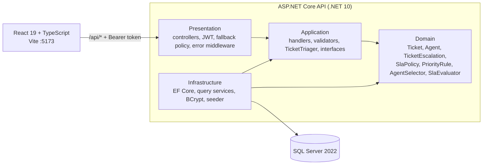
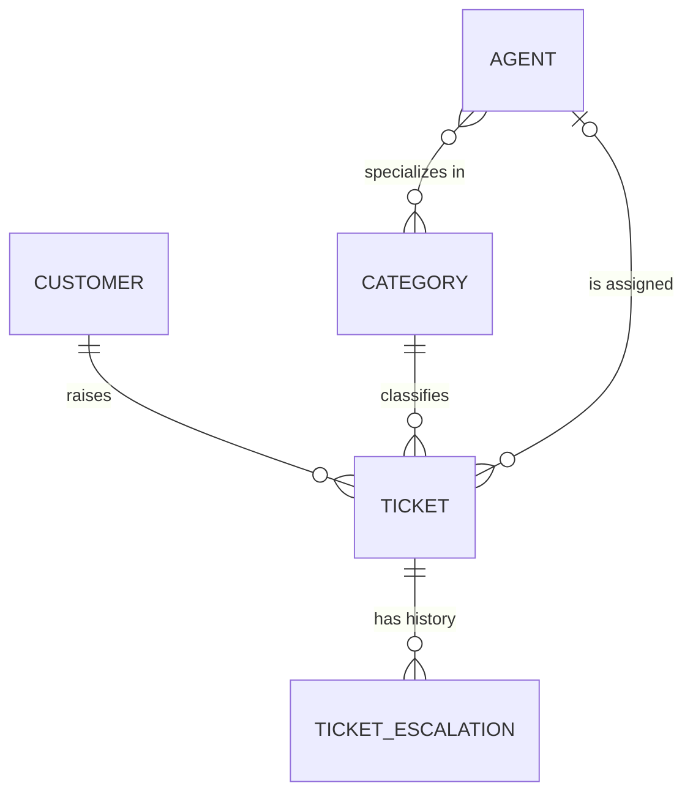

# Northwind Support Desk

> [!NOTE]
> **AI usage:** I used Claude throughout this assignment (planning, drafting code and tests, reviewing query
> shape, drafting docs). Every decision below is written down with what I rejected and why, and I can defend
> each one. See [AI usage](#ai-usage-disclosure) for what I checked and what I changed.

A support ticket management system: raise tickets, search and filter them, assign them to agents, and move
them through their lifecycle.

**.NET 10 Web API** + **React 19 / TypeScript** + **SQL Server**, in one monorepo.

---

## The Assignment & Summary of Implementation

All four tasks in **[`ASSIGNMENT_CANDIDATE.md`](ASSIGNMENT_CANDIDATE.md)** are complete.
**Fork:** https://github.com/Dinuka-Nonis/northwind-support (branch `Task-4`). Reasoning per task is in
**[`APPROACH.md`](APPROACH.md)**.

| # | Task | Status | Highlights |
|---|------|--------|------------|
| 1 | Defect fix and server-side filtering | Complete | DEFECT-117 fixed at the root (the fetch ignored most filters) with a regression test. Every list filter runs in SQL Server before the count and paging. |
| 2 | Ticket escalation and assignment | Complete | Triage on create (priority, due date, owner, each with a reason). Escalation one level up with an immutable history row. SLA status derived, never stored, and filterable in SQL. UI for all of it. |
| 3 | Login and authentication | Complete | BCrypt-hashed passwords, a 60-minute JWT, every endpoint closed by default by one fallback policy, `escalatedBy` taken from the token. Login page, route guard, in-memory session. |
| 4 | Dockerise the API | Complete | Multi-stage image, non-root, nothing baked in. `docker compose up` gives a migrated, seeded API. `GET /health` checks the database. |

---

## System Design



**Dependencies point inward.** Domain depends on nothing; Application on Domain; Infrastructure implements
the interfaces they declare; Presentation wires it together and is the only layer that knows about HTTP and
JWT. Architecture tests in the repo enforce it (Domain has no framework dependency, Application does not
reference ASP.NET, the EF model must match the migrations).

- **Rules are pure.** Priority, SLA window and owner selection take values, "now" and their numbers, and
  return a decision with a reason. `TicketTriager` assembles them so create and escalate share one copy.
- **Derive, do not store.** SLA status and an agent's open-ticket count are computed every time.
- **One place for a cross-cutting rule.** Sign-in is a fallback policy, errors go through one middleware, a
  `401` is handled in one web client, filters are one `ApplyFilters`.
- **Reads and writes differ.** Reads go through query services that project to DTOs without tracking.
  Writes go through the domain entities, and a use case saves once (the ticket and its history row together).
- **Settings are configuration.** The image holds code, never settings.



---

## Development Login Credentials

Every seeded agent gets the same password, **`Local_Dev_Agent1`**. It is a local development fixture, not a
secret: it exists only because the seeder runs in Development, and the database holds its BCrypt hash.

| Email (all `@northwind-support.example`) | Notes |
|---|---|
| `alex.turner`, `ben.osei`, `priya.nair`, `sara.lindqvist`, `marcus.doyle` | Active agents |
| `yuki.tanaka` | **Inactive.** Refused with the same `401` as a wrong password |

Try it in Swagger (`POST /api/auth/login`, copy the `token`, press **Authorize**) or from a terminal:

```bash
curl -s -X POST http://localhost:5043/api/auth/login -H "Content-Type: application/json" \
  -d '{"email":"alex.turner@northwind-support.example","password":"Local_Dev_Agent1"}'
```

---

## Design Decisions: Chosen, Rejected, and Why

| Topic | Chosen | Rejected | Why |
|---|---|---|---|
| Where the rules live | Small pure units in the domain, assembled by `TicketTriager` | Rules in handlers; a rules engine or MediatR | Create and escalate would each need a copy that could drift, and the rules could not be tested without a database. |
| SLA status | Derived from the dates every time (`SlaEvaluator`) | A stored status column | A stored status goes stale as time passes and needs a job to refresh it. |
| SLA filter | One more SQL condition in `ApplyFilters` | Filtering in C# | It would break the count and the paging. |
| SLA numbers | `Sla` configuration section; invalid or missing stops startup | Default numbers in code | A wrong config would otherwise go unnoticed. |
| Agent on escalation | Kept if active and qualified, no capacity check | Checking capacity first | The ticket already counts towards their load. A check would take it away because it became more important. |
| Credentials | Nullable `PasswordHash` column on `Agent` | A separate `Users` table | Every login is one agent and there are no roles. A second table is only a join. |
| Hashing | BCrypt (enhanced, work factor 12) behind `IPasswordHasher` | PBKDF2, a home-made hash | Maintained, deliberately slow, salted. Enhanced mode removes the 72-byte limit. |
| Token | HS256 JWT, 60 minutes, no refresh token | Sessions, a long lifetime | The API stays stateless and the token alone identifies the agent. Refresh tokens are out of scope. |
| Enforcing sign-in | A fallback policy that requires an authenticated user | `[Authorize]` on each controller | A new controller is closed by default. Opening one is a deliberate act. |
| Token in the browser | A module variable in memory | `localStorage`, `sessionStorage`, a cookie | Nothing is saved where a script can read it later. A refresh means signing in again. |
| Failed sign-in | One generic `401`, the real reason in the log | Saying which part was wrong | Nothing reveals which emails exist. |
| Runtime image | Debian `aspnet:10.0` | Alpine, chiseled | The brief checks `docker compose exec api whoami`, and a chiseled image has no shell. Alpine adds musl and no ICU. |
| Environment in Compose | `Development` by default | A new `RUN_MIGRATIONS` switch | The brief says migrate and seed "as it does today in Development". The cost is Swagger being on in Compose. |
| Migrations in production | A separate step (EF migration bundle), documented | The app migrating itself | See [Production migration strategy](#production-migration-strategy). |

---

## Defect & Filter Implementations

### Task 1.1: DEFECT-117
- **Root cause:** the ticket list effect depended only on `search`, `page` and `pageSize`. Changing Status or
  any other filter updated state but never ran `load`, so the UI showed stale data.
- **Fix:** search is debounced (300 ms) into the committed `filters`, and `useAsyncData` reloads whenever the
  committed `filters` change. Dropdowns commit immediately. No remount or `key` tricks.
- **Verify:** change Status to *In progress* with DevTools open and an immediate `GET /api/tickets?...status=InProgress`
  goes out. Automated: `useTicketList.test.ts` (fake timers).

### Task 1.2: Server-side filtering
- `TicketQueries.ApplyFilters` ANDs one optional `Where` per bound filter, then `CountAsync` on the filtered
  query, then sort and page. That order keeps `totalCount` and the pager correct.
- **SQL check:** tests run against in-memory SQLite with an EF command interceptor, so the logged SQL shows
  the filter is in the database, not evaluated on the client.
- **Extensible:** Task 2 added `slaStatus` as one property and one `if` block.

---

## Task 2: Escalation, Triage & Assignment

- **Triage on create:** `PriorityRule` (requested, Medium if none, always Critical when the category's flag says
  so), `SlaPolicy` (window by priority and tier, due date) and `AgentSelector` (active, a specialist when the
  category needs one, strictly below their limit, fewest open tickets, lowest id on a tie). `POST /api/tickets`
  returns `201` with a `triage` object of reasons, even when nobody is eligible (unassigned).
- **SLA settings** (`Sla` in `appsettings.json`): base windows Critical 4 h, High 8 h, Medium 24 h, Low 72 h;
  Premium multiplier 0.5; 1 h floor for Premium; At risk at 25% of the window left.
- **Escalation:** `POST /api/tickets/{id}/escalate` raises one level, recomputes the due date from the moment
  of escalation, keeps or reselects the owner, and saves the ticket and a `TicketEscalations` row together.
  `409` for Critical, Resolved or Closed, with the real reason, and nothing is saved. Reason is 5 to 500
  characters. `GET /api/tickets/{id}/escalations` returns the history, newest first.
- **SLA status:** Within SLA, At risk, Breached, Met or No SLA, from the dates. Exactly 25% left and due
  exactly now are both At risk; resolved on the due date is Met.
- **SLA filter:** `slaStatus` runs in SQL with `EF.Functions.DateDiffSecond`, before the count and paging,
  using the same rule as `SlaEvaluator`. One "now" per request is shared by the filter and the row labels.
- **UI:** `SlaIndicator` shows every state with its own words and symbol (● ▲ ✕ ✓ –), so it does not rely on
  colour alone. SLA status filter, escalation panel with history, and the triage result after create.
- **Spec ambiguities I decided:** priority default and forced Critical; keep the agent with no capacity
  check; tie goes to the lowest id; "open" means not Resolved or Closed; the at-risk window starts at creation
  even after an escalation; the 1 h floor applies to Premium only and Premium is never longer than Standard;
  at the limit means full; nobody eligible is a normal result; the new due date counts from escalation; a
  refusal names its real reason; the exact boundaries above.

---

## Task 3: Authentication & Security

- **Endpoints:** `POST /api/auth/login` returns a token, its expiry and the agent. A wrong email, a wrong
  password, an inactive agent and an agent with no hash give the identical `401`. `GET /api/auth/me` returns
  the signed-in agent.
- **Token:** HS256 JWT with `sub`, `name`, `email`, `jti`. The API checks signature, issuer, audience and
  expiry with no clock skew. Lifetime is 60 minutes (`Jwt:LifetimeMinutes`). The key comes from `Jwt__Key`,
  must be at least 32 bytes, and a missing or short key stops the API at startup.
- **Authorization:** a fallback policy closes every endpoint with no authorization of its own. Only login and
  `/health` are opened, each deliberately. Swagger is middleware, so the policy never sees it.
- **Actor integrity:** the escalate request has only a `reason`. The agent's name is read from the token, so a
  caller cannot record an escalation under someone else.
- **Web:** `/login` page, a route guard that remembers the wanted page (inside the app only), the name and a
  Log out button, and any `401` that carried the current token clears the session. The token lives in memory.

---

## Task 4: Docker & Operational Architecture

### Multi-stage build and image footprint
1. **Build** (`mcr.microsoft.com/dotnet/sdk:10.0`): copies `global.json`, `Directory.Build.props`,
   `Directory.Packages.props` and the four project files, runs `dotnet restore`, **then** copies the source and
   publishes. A code change reuses the restore layer.
2. **Runtime** (`mcr.microsoft.com/dotnet/aspnet:10.0`): runs as the non-root `app` user on plain HTTP 8080.
   Nothing but the port is baked in. `appsettings.Development.json` is excluded from every publish, and `Sla`
   moved to `appsettings.json` so the image still starts.

### Verification checklist
1. **Clean run:** `docker compose down -v && docker compose up --build` ends with `/health` answering `200`;
   login works; `/api/tickets` returns the 40 seeded tickets with a token and `401` without one.
2. **Layer caching:** after changing one `.cs` file, `docker compose build api` shows the restore step `CACHED`.
3. **Non-root:** `docker compose exec api whoami` prints `app`.
4. **No Development settings in the image:** `docker compose exec api ls /app` shows no `appsettings.Development.json`.
5. **Web app:** `VITE_API_PROXY_TARGET=http://localhost:5080 npm run web` signs in and lists tickets.

`GET /health` returns `200 Healthy` or `503 Unhealthy` with no data in the body, and needs no token.

### Production migration strategy
Compose runs as `Development`, so the API migrates and seeds on start. In a real deployment set
`ASPNETCORE_ENVIRONMENT=Production` (migrate, seed and Swagger are all off) and run migrations as a separate
step before the new version starts, using an EF Core migration bundle:

```bash
npm run ef -- migrations bundle --self-contained -r linux-x64 -o efbundle
./efbundle --connection "<account that may change the schema>"
```

- **Replicas would race** to migrate the same database. A deploy step runs once.
- **The app's login should not have schema rights.** Only the deploy step needs DDL permission.
- **A failed migration should not crash-loop the app.** As a step it fails the deploy and the old version keeps running.
- **It can be reviewed and rolled back** (`dotnet ef migrations script`), which startup code cannot.


---

## Database Schema & Indexing Decisions

- **`Agents.PasswordHash`:** nullable `nvarchar(256)` (migration `AddAgentPasswordHash`). Nullable so the migration
  is safe for existing rows. 256 leaves room if the algorithm changes.
- **`TicketEscalations`:** one immutable row per escalation (before and after priority, due date and agent,
  reason, actor, time), with `IX_TicketEscalations_TicketId_EscalatedAtUtc` serving "history for one ticket,
  newest first".
- **`Agents.Email`:** a unique index, used by the login lookup.
- **No stored SLA status, window start or open count.** They are derived (see System Design).
- **No extra indexes on the filter columns.** With 40 seeded tickets they would change nothing.

---

## Testing Strategy

```bash
npm test      # dotnet test, then the web tests (Vitest). Neither needs a database.
```

| Area | What is covered |
|---|---|
| Task 1 | `useTicketList`: filter change requests, search debounce, DEFECT-117 regression. `TicketQueriesFilterTests`: priority, AND combination, customer-name search, paging over a filtered set. |
| Task 2 | SLA policy (all priorities and tiers, the floor, config changes), priority rule, agent selection, escalation (every refusal, nothing saved on a `409`), SLA status at every boundary, the SLA filter compared with `SlaEvaluator`, candidates in one query. Web: indicator states, filter, escalation panel. |
| Task 3 | Hasher, each way login can fail, token claims and exact expiry, enforcement on a small host using the real `AddJwtAuthentication` (no, expired, tampered and wrong-key tokens all `401`). Web: token attached, `401` clears the session, guard redirect. |
| Architecture | Layer rules, and the EF model against the migrations. |

**Deliberately not tested**
- **Task 4 has no automated test**, as the brief says. The five checks above were run by hand.
- **At risk and Within SLA filters** need `DATEDIFF`, which SQLite does not have. I ran them by hand against
  SQL Server and read the generated SQL.
- **Browser end-to-end tests.** Out of scope for the two days.

---

## AI Usage Disclosure

- **Tool:** Claude, for exploring the repo, planning each task into commits, drafting code and tests,
  reviewing the EF migration and SQL shape, and drafting the docs.
- **Workflow:** rules first, each with its tests, then persistence, then the API, then the web, then docs.
- **Changed from the first plan:**
  - The login handler is registered in the step that adds `ITokenIssuer`, because Development validates the
    whole service graph at startup.
  - `Jwt__Key=replace-me` in `.env.example` would crash the container (the key is too short on purpose), so
    it is commented out and Compose supplies a fake, published default.
  - Reading the code before the Dockerfile showed `Sla` existed only in the Development file, so it moved.
  - Premium is capped at the base window, which the spec did not ask for.
- **Verified by hand:** the checks under each task, including the same `401` for a wrong email and wrong
  password, inactive Yuki refused, hashes only in the table, the redirect to login and back, and the
  `409` path in the escalation panel.

---

## Known Limitations & Out-of-Scope Items

- **SLA:** At risk can appear early after an escalation (the window starts at creation). The At risk and Within SLA filters need SQL Server. The optional SLA summary report is not built.
- **Assignment:** two tickets created at the same moment can both take an agent's last slot.
- **Auth:** no lockout, rate limiting, refresh tokens, revocation or password reset. A deactivated agent keeps access for up to 60 minutes, and outside Development nobody can sign in.
- **Token:** it is only in memory, so a refresh means signing in again. Production would use an `httpOnly` cookie.
- **Docker:** the container runs plain HTTP as Development, with a fake published JWT key that must never leave a local machine. Production migrations are documented, not built.
- **Out of scope, as the brief says:** Kubernetes, a registry, CI/CD, a web Dockerfile.

**Time spent (rough):** Task 1 ~3.5 h, Task 2 ~7.5 h, Task 3 ~4.5 h, Task 4 ~1.5 h.

---

## Quick Start & Running Locally

**Prerequisites:** Node.js 22 (`.nvmrc`), Docker. The .NET SDK 10 (`global.json`) is only needed for Option B.
The two options differ only in where the API runs, which decides what the web app talks to.

**Option A: API in Docker**
```bash
npm install
docker compose up --build                                  # SQL Server, then the API once it is healthy
curl -i http://localhost:5080/health                       # 200 Healthy
VITE_API_PROXY_TARGET=http://localhost:5080 npm run web    # PowerShell: $env:VITE_API_PROXY_TARGET="http://localhost:5080"; npm run web
```
Put `VITE_API_PROXY_TARGET=http://localhost:5080` in a git-ignored `apps/web/.env.local` to skip typing it.
Stop with `docker compose down`, or wipe the database with `docker compose down -v`.

**Option B: API from source**
```bash
npm install
npm run db:up      # SQL Server 2022 in Docker on localhost:1433
npm run api        # terminal 1: migrates, seeds, then serves
npm run web        # terminal 2: no variable needed
```

| What | Option A | Option B |
|---|---|---|
| Web app | http://localhost:5173 | http://localhost:5173 |
| API | http://localhost:5080 | https://localhost:7043 (also http://localhost:5043) |
| Swagger | http://localhost:5080/swagger | https://localhost:7043/swagger |

Sign in at `/login` with `alex.turner@northwind-support.example` and `Local_Dev_Agent1`. Outside Development
the API needs `Jwt__Key` (32 characters or more, see `.env.example`) and refuses to start without it.

### API at a glance

| Endpoint | Description |
|---|---|
| `POST /api/auth/login` | Token, expiry and agent. The only endpoint (with `/health`) open without a token. |
| `GET /api/auth/me` | The signed-in agent, or `401`. |
| `GET /health` | `200 Healthy` or `503 Unhealthy`. |
| `GET /api/tickets` | Paged list. Filters: `search`, `status`, `priority`, `slaStatus`, `categoryId`, `customerId`, `assignedAgentId`, `unassignedOnly`, `sortBy`, `sortDirection`. |
| `POST /api/tickets` | Create with triage. Returns a `triage` object. |
| `POST /api/tickets/{id}/escalate` · `GET /api/tickets/{id}/escalations` | Escalate (body: `reason`) and read the history. |
| `GET /api/tickets/{id}` · `PATCH .../status` · `PATCH .../assignment` | One ticket, change status, change assignee. |
| `GET /api/customers` · `/api/agents` · `/api/categories` | Reference data. |

Every other endpoint needs `Authorization: Bearer <token>`, otherwise `401`. Errors are `ProblemDetails`
(`400`, `404`, `409`), except a missing token, which gets the framework's empty `401`.

### Troubleshooting

| Symptom | Fix |
|---|---|
| Web shows "Unable to load tickets" | `VITE_API_PROXY_TARGET` points at the wrong API. Use `5080` for Docker, nothing for `npm run api`. |
| The API will not start and mentions `Jwt` | The key is missing or shorter than 32 bytes. Remove a short value such as `replace-me` from `.env`. |
| `/health` answers `503` | The API cannot reach SQL Server. Wait about 20 s and check `docker compose logs api`. After changing `MSSQL_SA_PASSWORD`, run `docker compose down -v`. |
| Back on the login page | The token expired after 60 minutes, or the page was refreshed. Sign in again. |
| Port 5080 is in use | Change the left side of `"5080:8080"` in `docker-compose.yml`. |